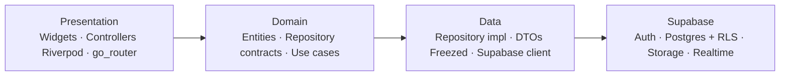
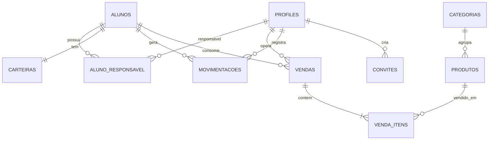
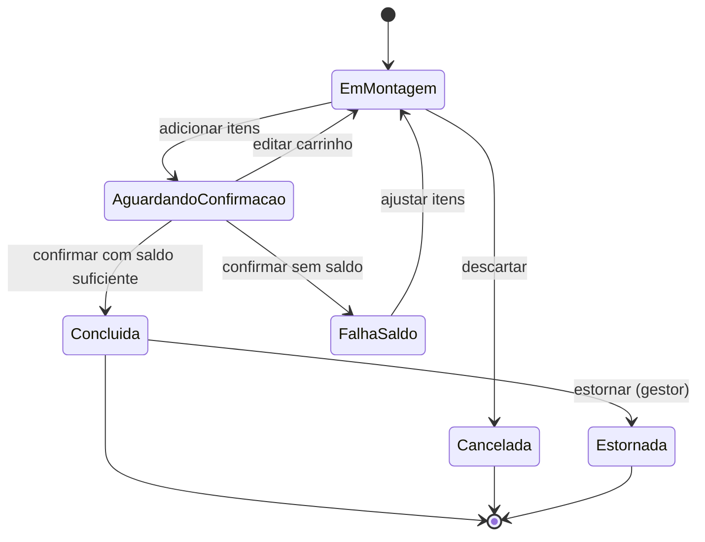
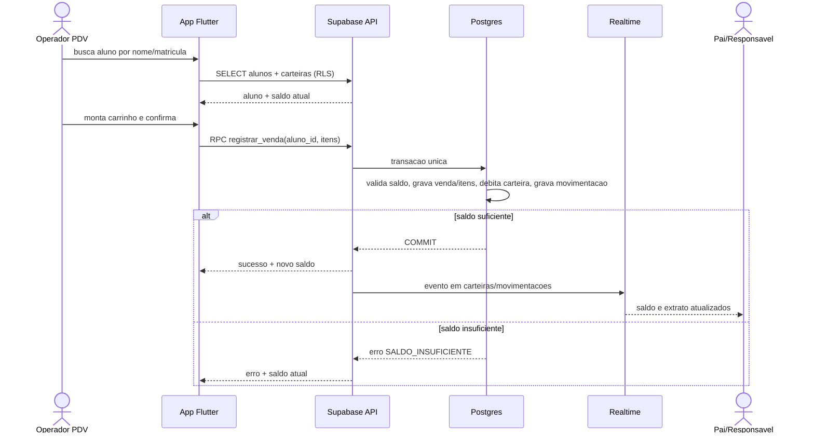
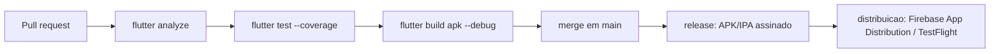

# 02 — Arquitetura Técnica (Rodada 2)

> **Projeto:** Cantina Fácil · **Atualizado:** 2026-11-10 · **Status:** Rodada 2 concluída — aguardando gate para Rodada 3

## 1. Decisões da Rodada 2

| # | Pergunta | Resposta |
|---|---|---|
| P1 | Plataformas | **(a)** Android 8+ (API 26) e iOS 14+; gerar `ios/` com `flutter create . --platforms=ios` |
| P2 | Autenticação | **(a)** E-mail/senha; operador/gestor por convite do gestor; pai se cadastra e vincula filho por matrícula + aprovação |
| P3 | Recursos no MVP | **(a)** Online-first; sem push/offline/impressão; analytics básico; QR pós-MVP |
| P4 | Consistência de saldo | **(a)** RPC Postgres atômica + Realtime + cache Riverpod |
| P5 | Navegação/estrutura | **(a)** `go_router` com guards por role + feature-first |

## 2. Stack e versões

| Item | Decisão |
|---|---|
| Flutter | Stable (SDK constraint atual `^3.13.0`; Dart 3.13) |
| Android | `minSdk 26` (Android 8.0); `targetSdk` = stable |
| iOS | deployment target 14.0 (pasta `ios/` a gerar) |
| Backend | Supabase — Auth, Postgres + RLS, Storage, Realtime |
| Estado | `flutter_riverpod` 2.x + `riverpod_annotation` + `riverpod_generator` (build_runner) |
| Navegação | `go_router` (guards por role via `redirect`) |
| HTTP/Backend SDK | `supabase_flutter` 2.x |
| Modelos | `freezed_annotation` + `json_annotation` (codegen) |
| Utilitários | `intl` (moeda BRL/datas), `google_fonts` (já instalado) |
| Testes | `flutter_test`, `mocktail`, `golden_toolkit` (goldens opcionais) |
| Lint | `flutter_lints` (já) + `riverpod_lint`/`custom_lint` |

> Versões exatas serão fixadas na Sprint 1 com `flutter pub add`; os majors acima são o alvo.

## 3. Arquitetura em camadas

Padrão Andrea Bizzotto (feature-first):

- **presentation** — widgets, páginas, controllers Riverpod (`@riverpod`), router e guards.
- **domain** — entidades puras, contratos de repositório, regras de negócio e use cases dos fluxos críticos (venda, recarga, estorno).
- **data** — DTOs (Freezed/JSON), implementação dos repositórios, acesso ao Supabase (RPC, tabelas, Storage, Realtime).



Regras:

- `presentation` nunca fala com Supabase direto — sempre via repositório.
- Regra de negócio de dinheiro **nunca** roda no client: débito/recarga são RPCs no Postgres.
- Um controller por fluxo (`@riverpod class PdvController`), `AsyncNotifier` para estados assíncronos e `StreamProvider` para Realtime.

## 4. Estrutura de pastas

```
lib/
├── main.dart                      # bootstrap + Supabase.initialize + ProviderScope
└── src/
    ├── app.dart                   # MaterialApp.router
    ├── core/
    │   ├── config/                # env (URL/anon key), supabase_client provider
    │   ├── router/                # app_router.dart + guards por role
    │   ├── theme/                 # tema atual (Lato/Dosis) preservado
    │   ├── utils/                 # formatadores de moeda/data, validators
    │   ├── errors/                # Failure, mapeamento de erros Supabase
    │   └── widgets/               # componentes compartilhados
    └── features/
        ├── auth/                  # login, cadastro, convite, recuperar senha
        ├── vinculo/               # matrícula, aprovação pai↔aluno
        ├── alunos/                # cadastro/consulta de alunos
        ├── pdv/                   # busca aluno, carrinho, confirmação de venda
        ├── saldo/                 # carteira, extrato (pai e operador)
        ├── produtos/              # catálogo + CRUD do gestor (Storage)
        └── gestao/                # recargas, aprovações, relatório básico
```

Cada feature repete `presentation/`, `domain/`, `data/` conforme necessidade.

## 5. Modelo de dados

Convenções: **valores em centavos (`bigint`)**; nomes de tabelas em pt-BR; `id uuid` com `gen_random_uuid()`; timestamps `timestamptz`.

| Tabela | Campos principais | Observação |
|---|---|---|
| `profiles` | id (= `auth.users.id`), nome, email, role (`gestor`/`operador`/`responsavel`), criado_em | role protegida por RLS |
| `alunos` | id, nome, matricula (unique), turma, ativo | dados mínimos de menor |
| `aluno_responsavel` | aluno_id, responsavel_id, status (`pendente`/`aprovado`/`rejeitado`), aprovado_por, aprovado_em | N:N — pai e mãe no mesmo aluno |
| `carteiras` | aluno_id (PK), saldo_centavos, atualizado_em | escrita **somente** via RPC |
| `categorias` | id, nome, ordem, ativo | — |
| `produtos` | id, categoria_id, nome, descricao, preco_centavos, imagem_path, ativo | imagem no bucket `produtos` |
| `vendas` | id, aluno_id, operador_id, total_centavos, status (`concluida`/`estornada`), criada_em | — |
| `venda_itens` | id, venda_id, produto_id, quantidade, preco_unitario_centavos | preço congelado na venda |
| `movimentacoes` | id, aluno_id, tipo (`recarga`/`venda`/`estorno`), valor_centavos (assinado), venda_id, operador_id, criada_em | ledger imutável / auditoria |
| `convites` | id, email, role, criado_por, expira_em, usado_em | operador/gestor |



RPCs (`SECURITY DEFINER`, validação de role dentro da função):

- `registrar_recarga(p_aluno_id, p_valor_centavos)` — operador/gestor.
- `registrar_venda(p_aluno_id, p_itens jsonb)` — operador/gestor; valida saldo e preço vigente na mesma transação.
- `estornar_venda(p_venda_id)` — gestor; credita saldo e grava movimentação de estorno.

## 6. Ciclo de vida da venda



## 7. Fluxo de débito e recarga



Recarga segue o mesmo caminho com `registrar_recarga` (credita e grava movimentação `recarga`).

## 8. Autenticação e RBAC

- **Cadastro:** responsável por e-mail/senha (`auth.signUp`); operador/gestor **somente por convite** do gestor.
- **Convite:** Edge Function `admin-convidar` valida JWT `role=gestor` e chama `auth.admin.inviteUserByEmail`, criando `profiles` com o role.
- **Vínculo:** pai informa matrícula → cria `aluno_responsavel(status='pendente')` → operador/gestor aprova → acesso ao saldo liberado.
- **Guards no app:** `go_router` redireciona por `role`; cada perfil tem shell próprio (PDV, pai, gestão).

| Ação | Pai | Operador | Gestor |
|---|---|---|---|
| Ver saldo/extrato dos próprios filhos | ✅ | — | — |
| Consultar saldo de qualquer aluno | — | ✅ | ✅ |
| Registrar recarga | — | ✅ | ✅ |
| Registrar venda | — | ✅ | ✅ |
| Estornar venda | — | — | ✅ |
| CRUD de produtos/categorias | — | — | ✅ |
| Aprovar vínculo pai↔aluno | — | ✅ | ✅ |
| Convidar operador/gestor | — | — | ✅ |
| Relatório básico de vendas | — | — | ✅ |

## 9. Tempo real

- Canais filtrados por `aluno_id` (carteiras e movimentações) — o pai só assina os filhos aprovados.
- Operador/gestão assinam vendas do dia da cantina.
- `unsubscribe` ao sair da tela; spike de RLS + Realtime na Sprint 1 (risco R6).
- Fallback: `pull-to-refresh` quando o canal cair.

## 10. Estratégia de testes

| Nível | Escopo | Ferramenta |
|---|---|---|
| Unit | entidades, regras de valor, mapeamento DTO↔entidade, controllers com repositório mockado | `flutter_test` + `mocktail` |
| Widget | login, PDV (busca/carrinho/erro de saldo), saldo/extrato com providers sobrescritos | `flutter_test` + `ProviderScope(overrides:)` |
| Integration | fluxo venda + recarga + estorno em projeto Supabase de teste; RLS negativa (pai não vê outro aluno) | `integration_test` |
| Golden | telas principais (login, PDV, saldo) | `golden_toolkit` (Should) |
| Banco | testes de RPC e policies (pgTAP/scripts SQL) | Supabase CLI (Should) |

## 11. CI/CD



- GitHub Actions com `subosito/flutter-action` (cache de pub).
- `analyze` e `test` são obrigatórios para merge (branch protection).
- Segredos (Supabase URL/anon key de CI) em GitHub Secrets; **nunca** service role no app.
- Deploy do schema Supabase via CLI/migrations versionadas no repo.

## 12. Segurança e LGPD

- **Minimização:** aluno → nome, matrícula, turma; responsável → nome e e-mail. Sem CPF, endereço ou telefone do menor.
- **Consentimento:** vínculo só após aprovação; termos e política de privacidade no cadastro.
- **RLS em todas as tabelas**; escrita de saldo apenas por RPC `SECURITY DEFINER` com checagem de role.
- **Ledger imutável:** `movimentacoes` sem policy de UPDATE/DELETE; correção só por estorno auditado.
- **Storage:** bucket `produtos` com leitura autenticada e escrita apenas do gestor; limite de tamanho/tipo de arquivo.
- **Retenção:** definir expurgo após o ciclo letivo + 1 ano; registrar no relatório da Sprint 3.
- **Logs:** nunca logar e-mail/senha/saldo em texto; erros mapeados para mensagens genéricas no app.

## 13. Acessibilidade

- Contraste AA no tema atual (validar tokens do Material 3 claro/escuro).
- Alvos de toque ≥ 48 dp; botões de venda e recarga com rótulos semânticos.
- Escala de fonte até 200% sem overflow nas telas de PDV e saldo.
- Valores monetários com `Semantics` ("doze reais e cinquenta centavos").
- TalkBack/VoiceOver no fluxo crítico de venda (checklist de DoD).

## 14. Suposições pendentes

- [SUPOSIÇÃO] **Cantina única** (sem multi-tenant) neste ciclo.
- [SUPOSIÇÃO] Um aluno pode ter **mais de um responsável** (N:N).
- [SUPOSIÇÃO] Operador e gestor podem aprovar vínculos; estorno é exclusivo do gestor.
- [SUPOSIÇÃO] Recarga e venda sempre em BRL, valores inteiros em centavos.
- [SUPOSIÇÃO] Web permanece scaffolded apenas para desenvolvimento; alvo de entrega é Android/iOS.
