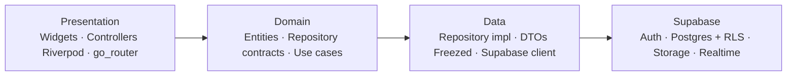
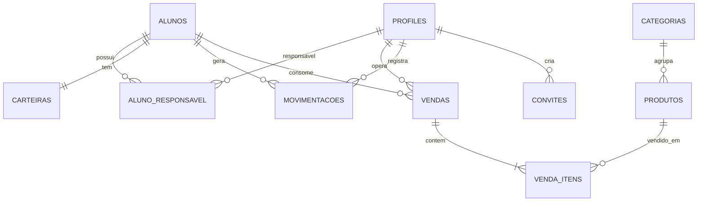
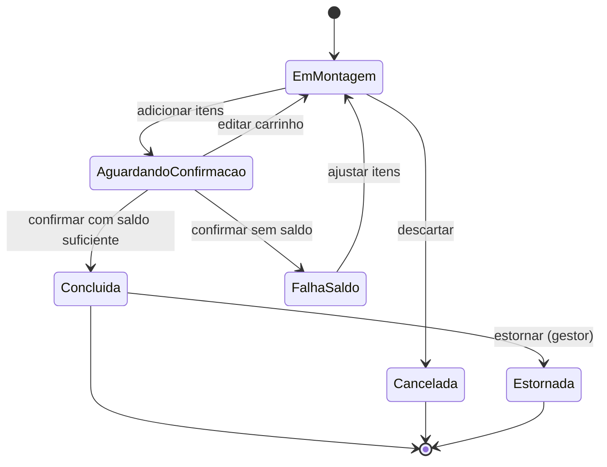
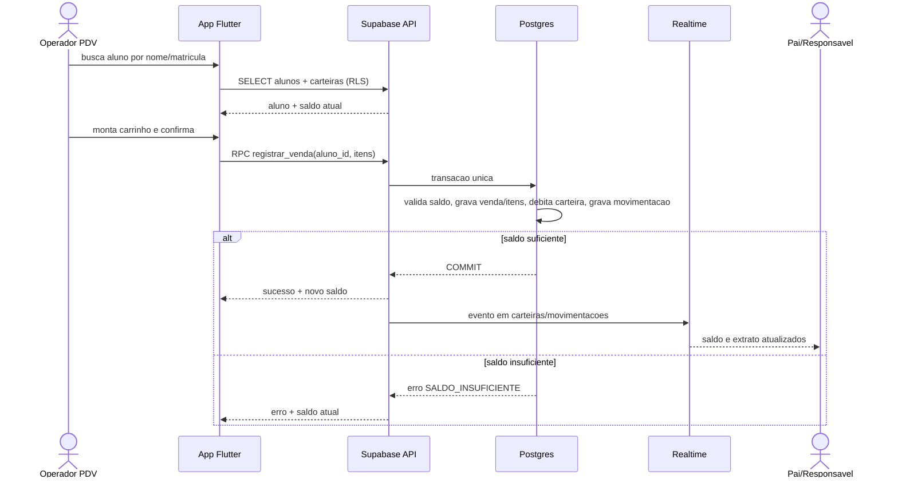
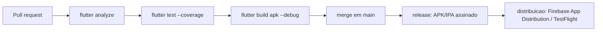

# 04 — Plano Consolidado (Rodada 4)

> **Projeto:** Cantina Fácil · **Atualizado:** 2026-11-11 · **Status:** aguardando `APROVO O PLANO`

## 1. Resumo executivo

- App Flutter (Android/iOS) com **3 perfis**: responsável, operador de PDV e gestor.
- Venda no balcão com **débito atômico** do crédito do aluno via RPC no Postgres.
- Recarga **presencial** lançada pelo operador no MVP; Pix automático fica no pós-MVP.
- Responsável acompanha **saldo e extrato em tempo real** (Supabase Realtime + RLS).
- Backend único **Supabase** (Auth, Postgres/RLS, Storage, Realtime); sem backoffice web.
- Arquitetura **feature-first** (presentation/domain/data) com **Riverpod annotations** e `go_router`.
- **3 sprints de 1 semana**: fundação → venda → gestão/entrega.
- Capacidade: **5 pessoas × 8 h × 0,7 = 28 h/sprint** (≈ 9–10 pts/sprint).
- Backlog das sprints: **11 histórias, 27 pontos**; pós-MVP: 9 histórias, 27 pontos.
- Todo item tem CA testável, BDD (feliz + exceção) e notas técnicas.

## 2. Escopo MVP vs pós-MVP

| Escopo | Itens | Entra no MVP? |
|---|---|---|
| Fundação (setup, Supabase, RLS, CI) | CF-001, CF-002 | ✅ |
| Conta e acesso (login, convite, sessão) | CF-003 | ✅ |
| Alunos e vínculo com aprovação | CF-004 | ✅ |
| Catálogo no PDV | CF-005 | ✅ |
| Carrinho + débito atômico | CF-006, CF-007 | ✅ |
| Recarga presencial | CF-008 | ✅ |
| Saldo e extrato realtime | CF-009 | ✅ |
| CRUD de produtos com imagem | CF-010 | ✅ |
| E2E + acessibilidade | CF-011 | ✅ |
| Relatório do dia | CF-012 | ⏭️ pós-MVP |
| Estorno auditado | CF-013 | ⏭️ pós-MVP |
| Pix automático | CF-014 | ⏭️ pós-MVP |
| QR Code do aluno | CF-015 | ⏭️ pós-MVP |
| Push (compra/saldo baixo) | CF-016 | ⏭️ pós-MVP |
| Exportação de relatórios | CF-017 | ⏭️ pós-MVP |
| PDV offline | CF-018 | ⏭️ pós-MVP |
| Impressão de recibo | CF-019 | ⏭️ pós-MVP |
| Limite de gasto | CF-020 | ⏭️ pós-MVP |

## 3. Diagramas (revisados)

**Arquitetura em camadas**

**Modelo de dados**

**Ciclo de vida da venda**

**Fluxo de débito e recarga**

**CI/CD**

## 4. Backlog completo

| ID | Épico | Título | Tipo | Área | Prio | Tam | Sprint | Depende de |
|---|---|---|---|---|---|---|---|---|
| CF-001 | CF-E01 | Configurar app Flutter com tema, rotas e CI | tech | Infra | P0 | 3 | Sprint 1 | — |
| CF-002 | CF-E01 | Configurar Supabase com schema, RLS e Storage | tech | Infra | P0 | 3 | Sprint 1 | — |
| CF-003 | CF-E02 | Autenticar com e-mail/senha e gerenciar perfis | feature | Auth | P0 | 3 | Sprint 1 | CF-001, CF-002 |
| CF-004 | CF-E03 | Cadastrar alunos e vincular responsável com aprovação | feature | Aluno | P1 | 3 | Sprint 2 | CF-002, CF-003 |
| CF-005 | CF-E04 | Consultar catálogo de produtos no PDV | feature | Produto | P1 | 2 | Sprint 2 | CF-002, CF-003 |
| CF-006 | CF-E05 | Montar carrinho de venda no PDV | feature | PDV | P0 | 3 | Sprint 2 | CF-004, CF-005 |
| CF-007 | CF-E05 | Debitar crédito com RPC atômica de venda | tech | PDV | P0 | 2 | Sprint 2 | CF-002, CF-006 |
| CF-008 | CF-E06 | Registrar recarga de crédito pelo operador | feature | Saldo | P1 | 2 | Sprint 3 | CF-002, CF-004 |
| CF-009 | CF-E06 | Consultar saldo e extrato do aluno em tempo real | feature | Saldo | P1 | 2 | Sprint 3 | CF-007, CF-008 |
| CF-010 | CF-E04 | Gerenciar produtos com imagem no Storage | feature | Produto | P1 | 2 | Sprint 3 | CF-002, CF-005 |
| CF-011 | CF-E08 | Testes E2E e acessibilidade do fluxo crítico | tech | Infra | P1 | 2 | Sprint 3 | CF-003, CF-006, CF-007, CF-008, CF-009 |
| CF-012 | CF-E07 | Ver relatório básico de vendas do dia | feature | Gestão | P2 | 2 | Backlog | CF-007 |
| CF-013 | CF-E07 | Estornar venda com auditoria | feature | Gestão | P2 | 3 | Backlog | CF-007 |
| CF-014 | CF-E06 | Recarregar crédito via Pix automático | feature | Saldo | P2 | 5 | Backlog | CF-008 |
| CF-015 | CF-E05 | Identificar aluno por QR Code no PDV | feature | PDV | P3 | 3 | Backlog | CF-006 |
| CF-016 | CF-E06 | Notificar compra e saldo baixo por push | feature | Saldo | P3 | 3 | Backlog | CF-009 |
| CF-017 | CF-E07 | Exportar relatórios avançados de vendas | feature | Gestão | P3 | 2 | Backlog | CF-012 |
| CF-018 | CF-E05 | Operar PDV offline com sincronização | feature | PDV | P3 | 5 | Backlog | CF-007 |
| CF-019 | CF-E05 | Imprimir recibo da venda | feature | PDV | P3 | 2 | Backlog | CF-007 |
| CF-020 | CF-E06 | Definir limite de gasto por aluno | feature | Saldo | P3 | 2 | Backlog | CF-007 |

## 5. Plano de sprints

### Sprint 1 — Fundação e acesso (9 pts · capacidade ~9–10)

| Item | Título | Pontos |
|---|---|---|
| CF-001 | Configurar app Flutter com tema, rotas e CI | 3 |
| CF-002 | Configurar Supabase com schema, RLS e Storage | 3 |
| CF-003 | Autenticar com e-mail/senha e gerenciar perfis | 3 |

**Risco:** versões de pacotes e curva de RLS/Realtime. **Mitigação:** spike dentro de CF-002; fixar versões no dia 1.

### Sprint 2 — Fluxo de venda (10 pts · capacidade ~9–10)

| Item | Título | Pontos |
|---|---|---|
| CF-004 | Cadastrar alunos e vincular responsável com aprovação | 3 |
| CF-005 | Consultar catálogo de produtos no PDV | 2 |
| CF-006 | Montar carrinho de venda no PDV | 3 |
| CF-007 | Debitar crédito com RPC atômica de venda | 2 |

**Risco:** concorrência no débito e preço adulterado. **Mitigação:** RPC com lock + testes SQL de concorrência na própria história.

### Sprint 3 — Gestão e entrega (8 pts · capacidade ~9–10, buffer 1–2)

| Item | Título | Pontos |
|---|---|---|
| CF-008 | Registrar recarga de crédito pelo operador | 2 |
| CF-009 | Consultar saldo e extrato do aluno em tempo real | 2 |
| CF-010 | Gerenciar produtos com imagem no Storage | 2 |
| CF-011 | Testes E2E e acessibilidade do fluxo crítico | 2 |

**Risco:** flakiness de Realtime no E2E. **Mitigação:** job de integração com timeout controlado; buffer de 1–2 pts para correções.

## 6. Matriz de rastreabilidade

| Requisito (01-visao) | História(s) | Critérios de aceite |
|---|---|---|
| RQ01 — Autenticação por perfil e sessão | CF-003 | CA01–CA08 |
| RQ02 — Vínculo responsável↔aluno com aprovação | CF-004 | CA01–CA08 |
| RQ03 — Cadastro e busca de aluno no PDV | CF-004, CF-006 | CA01–CA03 |
| RQ04 — Catálogo com preço e disponibilidade | CF-005 | CA01–CA07 |
| RQ05 — Venda com débito atômico de crédito | CF-006, CF-007 | CA01–CA08 |
| RQ06 — Saldo e extrato em tempo real | CF-009 | CA01–CA07 |
| RQ07 — Recarga de crédito presencial | CF-008 | CA01–CA07 |
| RQ08 — CRUD de produtos com imagem | CF-010 | CA01–CA07 |
| RQ09 — Relatório básico de vendas (Should) | CF-012 | CA01–CA04 |
| RQ10 — Estorno auditado (Should) | CF-013 | CA01–CA05 |
| RQ11 — LGPD, RLS e isolamento de dados | CF-002, CF-009, CF-011 | CA02/CA06/CA03 |
| RQ12 — Testes e acessibilidade do fluxo crítico | CF-011 | CA01–CA06 |

## 7. Riscos e mitigação

| # | Risco | Impacto | Mitigação |
|---|---|---|---|
| R1 | Débito duplo/saldo negativo por concorrência | Alto | RPC com `FOR UPDATE` + testes de concorrência (CF-007) |
| R2 | Erro operacional (aluno/valor errado) | Alto | Confirmação com nome/turma; auditoria em `movimentacoes`; estorno pós-MVP |
| R3 | LGPD / dados de menores | Alto | Minimização, consentimento no vínculo, RLS restritiva, retenção definida |
| R4 | Conectividade instável no balcão | Médio | Online-first com retry e feedback; offline no pós-MVP (CF-018) |
| R5 | Capacidade 100% comprometida (27/27 pts) | Alto | Should fora das sprints; fatiar antes de puxar; buffer na Sprint 3 |
| R6 | RLS/Realtime com comportamento inesperado | Médio | Spike na Sprint 1 (CF-002) e teste negativo no E2E (CF-011) |
| R7 | Custo/limite de canais Realtime | Baixo | 1 canal por tela, unsubscribe no dispose (CF-009) |
| R8 | Flakiness do E2E com Realtime | Médio | Timeout controlado + job noturno documentado (CF-011) |

## 8. Estimativa total

| Conjunto | Itens | Pontos | Horas aprox. (3 h/pt) |
|---|---|---|---|
| Sprint 1 | 3 | 9 | 27 h |
| Sprint 2 | 4 | 10 | 30 h |
| Sprint 3 | 4 | 8 | 24 h |
| **MVP (3 sprints)** | **11** | **27** | **~81 h** |
| Pós-MVP (Backlog) | 9 | 27 | ~81 h |
| **Total** | **20** | **54** | **~162 h** |

Capacidade do ciclo MVP: 3 × 28 h = **84 h** → buffer de ~3 h (~4%). O pós-MVP equivale a mais um ciclo de 3 sprints na mesma capacidade.
